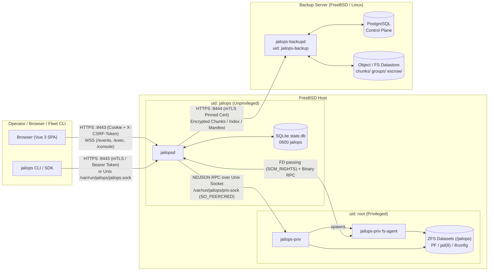

# JailOps Software Security Audit Report

**Audit Date:** November 2, 2026  
**Target Repository:** `jailops.net/jailops`  
**Audit Type:** Comprehensive Static, Architectural, Dependency (SBOM), and Infrastructure/CI-CD Security Audit  
**Primary Objective:** General Risk Reduction & Privilege Boundary Hardening  
> *This document was written with the assistance of AI. All text has been human-reviewed and verified.*
---

## Executive Summary

JailOps is a security-conscious FreeBSD jail and Linux-jail orchestration platform with a dedicated backup node (`jailops-backupd`), a declarative fleet manager (`jailops fleet`), and a privileged root helper (`jailops-priv`) designed so the network-facing daemon (`jailopsd`) can run as an unprivileged user (`jailops`).

The codebase demonstrates strong engineering discipline in many areas:
- Strict grammatical validation before rendering `pf.conf`, `jail.conf`, `rc.conf`, and `fstab` (preventing classic shell, PF rule, and SQL injection).
- Zero use of unsafe DOM sinks (`v-html`, `innerHTML`, `eval`) in the Vue 3 web consoles (`web/host`, `web/backup`), paired with strict Content Security Policy (CSP) headers.
- Parameterized SQL queries across both SQLite (`internal/store`) and PostgreSQL (`internal/node/ctl`), Argon2id password hashing with concurrency semaphores (`hashSem`), and per-IP/per-account lockout controls.
- Openat/`O_NOFOLLOW` traversal guards in `internal/priv/safefs.go` and `internal/repo/catalog/fs.go`.

However, our systematic audit uncovered **12 actionable security vulnerabilities and compliance gaps** (1 **Critical**, 3 **High**, 5 **Medium**, 3 **Low**). The most severe findings involve **local privilege escalation (`jailops` $\rightarrow$ `root`) across the `jailopsd`/`jailops-priv` privilege-separation boundary**, **cross-host chunk and escrow poisoning in the keyless backup repository (`jailops-backupd`)**, **SSRF and arbitrary root-owned file first-line exfiltration via the log-forwarding webhook API**, and **shared group-writable `/var/run/jailops` PID/socket race conditions**.

| ID | Title | Component | Severity | Likelihood | Impact |
| :--- | :--- | :--- | :---: | :---: | :---: |
| **VULN-01** | Privilege Escalation (`jailops` $\rightarrow$ `root`) via ZFS `mountpoint` Root Equality, `setuid`/`devices` Props, and `fsagent` Write Mode | `internal/priv`, `internal/fsagent`, `internal/repo/catalog` | **Critical** | Medium | Critical |
| **VULN-02** | Incomplete System-Path Overlap Check (`overlapsSystem`) Allows Storage Mounts Inside `/etc`, `/boot`, `/root`, and Helper State Directories | `internal/priv/roots.go`, `internal/priv/config.go` | **High** | Low–Medium | Critical |
| **VULN-03** | Cross-Host Backup Chunk Poisoning & Unverified Escrow Blob Lockout in Keyless Backup Node | `internal/node/session.go`, `internal/node/escrow.go`, `internal/node/client` | **High** | Medium | High |
| **VULN-04** | Log Forwarding Webhook SSRF & Root-Owned `0640` File First-Line Exfiltration + Symlink/TOCTOU in `CheckFile` | `internal/logfwd/send.go`, `sdk/api/logs.go` | **High** | Medium | High |
| **VULN-05** | Shared Group-Writable `/var/run/jailops` (`01771 root:jailops`) Enables PID File Hijacking and `priv.sock` Startup DoS | `packaging/rc.d/*`, `cmd/jailops-priv/main.go` | **Medium** | Medium | High |
| **VULN-06** | Incomplete `neverReceived` Property Stripping on `zfs receive` Omits `shareiscsi`, `devices`, `setuid`, and `exec` | `internal/priv/local.go` | **Medium** | Low–Medium | Medium |
| **VULN-07** | CI/CD Pipeline Supply-Chain Risks: Unpinned Third-Party GitHub Actions & Plaintext HTTP `apt` Mirror Rewrite as Root | `.github/workflows/ci.yml`, `.github/workflows/release.yml` | **Medium** | Medium | Medium |
| **VULN-08** | WebSocket `/console` and `/exec` Authentication Token Passed in URL Query Parameter (`?token=`) | `internal/server/mw.go`, `internal/server/console.go`, `internal/server/exec.go` | **Medium** | Medium | Medium |
| **VULN-09** | Unbounded Concurrent `fs.agent` Subprocesses (`maxConns = 16`) Without Per-Method Rate Limiting on `priv.sock` | `cmd/jailops-priv/main.go`, `internal/priv/fsagent.go` | **Medium** | Low–Medium | Medium |
| **VULN-10** | Unsanitized Control/ANSI Escape Sequences Written to `/dev/console` and Root Terminal in `setup-token` | `cmd/jailops-priv/appliance.go`, `packaging/rc.d/jailopsd` | **Low** | Low | Medium |
| **VULN-11** | Missing `Strict-Transport-Security` (HSTS) and `Permissions-Policy` Headers on HTTPS Listeners | `internal/server/mw.go`, `internal/backupd/mgmt.go` | **Low** | Low | Low |
| **VULN-12** | Pre-Release / Unreleased Go Toolchain (`go 1.27.3`) and Pseudo-Version Dependencies in `go.mod` | `go.mod`, `sdk/go.mod`, `prototypes/go.mod` | **Low** | Low | Low |

---

## 1. Scope and Objectives

### 1.1 Audit Scope
The audit encompassed all source code, third-party dependencies, build/release pipelines, and OS service configurations in the repository:

1. **Core Daemons & Binaries (`cmd/`)**:
   - `cmd/jailopsd`: Primary host and fleet-hub daemon (runs as unprivileged `jailops` user or `root`).
   - `cmd/jailops-priv`: Privileged root helper daemon on FreeBSD (`priv.sock`) and appliance setup/revert utilities.
   - `cmd/jailops-backupd`: Keyless deduplicating backup node daemon (runs on FreeBSD and Linux).
   - `cmd/jailops`: Operator CLI client, local recovery tool (`jailops backup recover`), and GitOps fleet manager (`jailops fleet`).
2. **Internal Go Packages (`internal/` — 59 packages)**:
   - Privileged boundary & host execution (`internal/priv`, `internal/fsagent`, `internal/sys/*`, `internal/render`, `internal/reconcile`, `internal/lifecycle`).
   - Authentication, RBAC, HTTP/WebSocket APIs, and stores (`internal/auth`, `internal/server`, `internal/service`, `internal/store`).
   - Backup cryptography, chunking, catalog extraction, and backup node (`internal/repo/*`, `internal/backup`, `internal/hostbackup`, `internal/node/*`, `internal/backupd`).
   - Catalog apps, log forwarding, and fleet GitOps (`internal/apps`, `internal/logfwd`, `internal/fleet/*`).
3. **Public SDK (`sdk/`, `sdk/api/`)**:
   - Wire types, validators, and HTTP/mTLS client library.
4. **Web Consoles (`web/`)**:
   - `@jailops/host` (`web/host`), `@jailops/backup` (`web/backup`), and `@jailops/shared` (`web/shared`) Vue 3 single-page applications embedded into `jailopsd` and `jailops-backupd`.
5. **Infrastructure, Packaging & CI/CD (`packaging/`, `.github/workflows/`, `.goreleaser.yaml`, `Justfile`)**:
   - FreeBSD `rc.d` scripts (`jailopsd`, `jailops_priv`, `jailops_revert`, `jailops_backupd`), Linux `systemd` unit (`jailops-backupd.service`), sample configurations, and GitHub Actions workflows.

### 1.2 Audit Objectives
- **General Risk Reduction**: Identify and remediate exploitable flaws across privilege boundaries, network APIs, backup cryptography, and deployment scripts.
- **Privilege Separation Verification**: Verify the security invariant documented in `docs/security-model.md`—specifically whether a compromised `jailopsd` process (running as user `jailops`) can escalate privileges to `root` on the FreeBSD host via `jailops-priv`.
- **Multi-Tenant & Multi-Host Isolation**: Verify project isolation in `jailopsd` and host isolation in `jailops-backupd`.
- **Supply Chain & SBOM Transparency**: Produce a complete Software Bill of Materials (SBOM) and evaluate CI/CD pipeline integrity.

---

## 2. Asset Inventory, Architecture & Software Bill of Materials (SBOM)

### 2.1 Software Asset Inventory

| Asset | Type | Language / Runtime | Default Execution Context | Primary Storage / State |
| :--- | :--- | :--- | :--- | :--- |
| `jailopsd` | Host & Hub Daemon | Go (`cmd/jailopsd`) | FreeBSD user `jailops:jailops` | `/var/db/jailops/state.db` (SQLite WAL), `/jailops/.jailops/` (JSON state) |
| `jailops-priv` | Privileged Root Helper | Go (`cmd/jailops-priv`) | FreeBSD user `root:wheel` (`uid 0`) | `/etc/jailops/priv.conf`, `/var/db/jailops-priv/` (grants, host firewall, WireGuard keys) |
| `jailops-backupd` | Backup Node Daemon | Go (`cmd/jailops-backupd`) | FreeBSD/Linux user `jailops-backup:jailops-backup` | PostgreSQL control plane + Local FS or S3 datastore (`chunks/`, `groups/`, `escrow/`) |
| `jailops` | CLI & Fleet Tool | Go (`cmd/jailops`) | Operator workstation / admin shell | `~/.config/jailops/config.yaml`, SOPS/age vault |
| `jailops.net/jailops/sdk` | Go Client SDK | Go (`sdk/`) | Imported by CLI, hub, and third-party consumers | In-memory |
| `@jailops/host` | Host Web UI | TypeScript / Vue 3 (`web/host`) | Embedded in `jailopsd` (`internal/webui`) | Browser memory + `HttpOnly` `__Host-jailops_session` cookie |
| `@jailops/backup` | Backup Web UI | TypeScript / Vue 3 (`web/backup`) | Embedded in `jailops-backupd` (`internal/backupui`) | Browser memory + `HttpOnly` `__Host-jailops_session` cookie |

### 2.2 Network Listeners, IPC Sockets & Data Flows



| Listener / Socket | Owner / Mode | Protocol & Auth | Purpose |
| :--- | :--- | :--- | :--- |
| `jailopsd` TCP (`:8443`) | `jailops:jailops` | HTTPS (TLS 1.2+, mTLS client cert, Bearer token, or Session Cookie + CSRF) | Host & Hub REST API v1, Web UI, WSS `/events`, `/exec`, `/console` |
| `/var/run/jailops/jailops.sock` | `jailops:jailops` (`0660`) | HTTP over Unix socket (`LOCAL_PEERCRED`: `uid 0`, daemon uid, or group `jailops` $\rightarrow$ `operator`) | Local CLI access without tokens |
| `/var/run/jailops/priv.sock` | `root:jailops` (`0600` configured) | NDJSON over Unix stream socket (`LOCAL_PEERCRED` verified against `daemon_uid`) | Unprivileged `jailopsd` $\rightarrow$ root `jailops-priv` RPC + `SCM_RIGHTS` FD passing |
| `jailops-backupd` TCP (`:8444`) | `jailops-backup` | HTTPS (TLS 1.3; mTLS pinned host certs for `/api/v1/repo/*`; Session/Token for `/api/v1/*`) | Backup host upload/download API + Backup management API & UI |
| `/var/run/jailops-backupd/admin.sock` | `jailops-backup` (`0600`) | HTTP over Unix socket (`SO_PEERCRED` / `LOCAL_PEERCRED`: `uid 0` only) | Local root CLI administration of `jailops-backupd` |

---

### 2.3 Software Bill of Materials (SBOM)

#### 2.3.1 Go Modules Overview
1. **Root Module (`jailops.net/jailops`)** — `go.mod` (Go `1.27.3`)
2. **SDK Module (`jailops.net/jailops/sdk`)** — `sdk/go.mod` (Go `1.27.3`, **0 external dependencies**)
3. **Prototypes Module (`jailops.net/jailops/prototypes`)** — `prototypes/go.mod` (Go `1.27.3`)

#### 2.3.2 Direct Go Dependencies (`go.mod`)

| Package | Version | License / Ecosystem | Usage in JailOps |
| :--- | :--- | :--- | :--- |
| `filippo.io/age` | `v1.3.2` | BSD-3-Clause | Master backup key offline escrow (`internal/repo/keys`) & fleet vault encryption (`internal/fleet/vault`) |
| `github.com/fergusstrange/embedded-postgres` | `v1.34.0` | Apache-2.0 | Embedded PostgreSQL for `jailops-backupd` integration tests |
| `github.com/getsops/sops/v3` | `v3.13.3` | MPL-2.0 | SOPS secret decryption in `internal/fleet/secrets` |
| `github.com/jackc/pgx/v5` | `v5.11.0` | MIT | PostgreSQL driver for `jailops-backupd` control plane (`internal/node/ctl`) |
| `github.com/klauspost/compress` | `v1.20.3` | BSD-3-Clause | Zstandard (`zstd`) chunk compression/decompression (`internal/repo/format`) |
| `github.com/spf13/cobra` | `v1.10.2` | Apache-2.0 | CLI command parsing (`cmd/jailops`, `cmd/jailops-backupd`) |
| `golang.org/x/crypto` | `v0.58.0` | BSD-3-Clause | `argon2` (password & keyfile KDF), `chacha20poly1305` (XChaCha20-Poly1305 AEAD), `hkdf` |
| `golang.org/x/net` | `v0.61.0` | BSD-3-Clause | HTTP/2 and network utilities |
| `golang.org/x/sys` | `v0.49.0` | BSD-3-Clause | Low-level FreeBSD/Linux syscalls (`unix.Openat`, `O_NOFOLLOW`, `SCM_RIGHTS`, xattrs) |
| `golang.org/x/term` | `v0.47.0` | BSD-3-Clause | Terminal raw mode and passphrase prompting |
| `gopkg.in/yaml.v3` | `v3.0.1` | MIT / Apache-2.0 | YAML configuration & fleet manifest parsing |
| `jailops.net/jailops/sdk` | `v0.0.0` (local `./sdk`) | Proprietary / Repo | Shared API wire types and client |
| `modernc.org/sqlite` | `v1.61.0` | BSD-3-Clause | Pure-Go SQLite driver for `jailopsd` operational database (`internal/store`) |

#### 2.3.3 Transitive (Indirect) Go Dependencies (`go.mod` — 130 packages)

<details>
<summary>Complete List of 130 Transitive Go Dependencies in <code>go.mod</code></summary>

| Module | Version | Module | Version |
| :--- | :--- | :--- | :--- |
| `cel.dev/expr` | `v0.25.1` | `cloud.google.com/go` | `v0.123.0` |
| `cloud.google.com/go/auth` | `v0.20.0` | `cloud.google.com/go/auth/oauth2adapt` | `v0.2.8` |
| `cloud.google.com/go/compute/metadata` | `v0.9.0` | `cloud.google.com/go/iam` | `v1.6.0` |
| `cloud.google.com/go/kms` | `v1.26.0` | `cloud.google.com/go/longrunning` | `v0.8.0` |
| `cloud.google.com/go/monitoring` | `v1.27.0` | `cloud.google.com/go/storage` | `v1.62.1` |
| `cpuguy83/go-md2man/v2` | `v2.0.7` | `filippo.io/edwards25519` | `v1.2.0` |
| `filippo.io/hpke` | `v0.4.0` | `github.com/Azure/azure-sdk-for-go/sdk/azcore` | `v1.21.1` |
| `github.com/Azure/azure-sdk-for-go/sdk/azidentity` | `v1.13.1` | `github.com/Azure/azure-sdk-for-go/sdk/internal` | `v1.12.0` |
| `github.com/Azure/azure-sdk-for-go/sdk/security/keyvault/azkeys` | `v1.4.0` | `github.com/Azure/azure-sdk-for-go/sdk/security/keyvault/internal` | `v1.2.0` |
| `github.com/AzureAD/microsoft-authentication-library-for-go` | `v1.7.1` | `github.com/GoogleCloudPlatform/opentelemetry-operations-go/detectors/gcp` | `v1.32.0` |
| `github.com/GoogleCloudPlatform/opentelemetry-operations-go/exporter/metric` | `v0.56.0` | `github.com/GoogleCloudPlatform/opentelemetry-operations-go/internal/resourcemapping` | `v0.56.0` |
| `github.com/ProtonMail/go-crypto` | `v1.4.1` | `github.com/aws/aws-sdk-go-v2` | `v1.41.6` |
| `github.com/aws/aws-sdk-go-v2/aws/protocol/eventstream` | `v1.7.9` | `github.com/aws/aws-sdk-go-v2/config` | `v1.32.16` |
| `github.com/aws/aws-sdk-go-v2/credentials` | `v1.19.15` | `github.com/aws/aws-sdk-go-v2/feature/ec2/imds` | `v1.18.22` |
| `github.com/aws/aws-sdk-go-v2/feature/s3/manager` | `v1.22.15` | `github.com/aws/aws-sdk-go-v2/internal/configsources` | `v1.4.22` |
| `github.com/aws/aws-sdk-go-v2/internal/endpoints/v2` | `v2.7.22` | `github.com/aws/aws-sdk-go-v2/internal/ini` | `v1.8.6` |
| `github.com/aws/aws-sdk-go-v2/internal/v4a` | `v1.4.23` | `github.com/aws/aws-sdk-go-v2/service/internal/accept-encoding` | `v1.13.8` |
| `github.com/aws/aws-sdk-go-v2/service/internal/checksum` | `v1.9.14` | `github.com/aws/aws-sdk-go-v2/service/internal/presigned-url` | `v1.13.22` |
| `github.com/aws/aws-sdk-go-v2/service/internal/s3shared` | `v1.19.22` | `github.com/aws/aws-sdk-go-v2/service/kms` | `v1.50.5` |
| `github.com/aws/aws-sdk-go-v2/service/s3` | `v1.99.1` | `github.com/aws/aws-sdk-go-v2/service/sso` | `v1.30.16` |
| `github.com/aws/aws-sdk-go-v2/service/ssooidc` | `v1.35.20` | `github.com/aws/aws-sdk-go-v2/service/sts` | `v1.42.0` |
| `github.com/aws/smithy-go` | `v1.25.0` | `github.com/blang/semver` | `v3.5.1+incompatible` |
| `github.com/cenkalti/backoff/v4` | `v4.3.0` | `github.com/cespare/xxhash/v2` | `v2.3.0` |
| `github.com/cloudflare/circl` | `v1.6.3` | `github.com/cncf/xds/go` | `v0.0.0-20260202195803-dba9d589def2` |
| `github.com/davecgh/go-spew` | `v1.1.2-0.20180830191138-d8f796af33cc` | `github.com/dustin/go-humanize` | `v1.0.1` |
| `github.com/envoyproxy/go-control-plane/envoy` | `v1.37.0` | `github.com/envoyproxy/protoc-gen-validate` | `v1.3.3` |
| `github.com/fatih/color` | `v1.19.0` | `github.com/felixge/httpsnoop` | `v1.0.4` |
| `github.com/getsops/gopgagent` | `v0.0.0-20241224165529-7044f28e491e` | `github.com/go-jose/go-jose/v4` | `v4.1.4` |
| `github.com/go-logr/logr` | `v1.4.3` | `github.com/go-logr/stdr` | `v1.2.2` |
| `github.com/goccy/go-yaml` | `v1.19.2` | `github.com/golang-jwt/jwt/v5` | `v5.3.1` |
| `github.com/google/go-cmp` | `v0.7.0` | `github.com/google/s2a-go` | `v0.1.9` |
| `github.com/google/shlex` | `v0.0.0-20191202100458-e7afc7fbc510` | `github.com/google/uuid` | `v1.6.0` |
| `github.com/googleapis/enterprise-certificate-proxy` | `v0.3.15` | `github.com/googleapis/gax-go/v2` | `v2.22.0` |
| `github.com/goware/prefixer` | `v0.0.0-20160118172347-395022866408` | `github.com/hashicorp/errwrap` | `v1.1.0` |
| `github.com/hashicorp/go-cleanhttp` | `v0.5.2` | `github.com/hashicorp/go-multierror` | `v1.1.1` |
| `github.com/hashicorp/go-retryablehttp` | `v0.7.8` | `github.com/hashicorp/go-rootcerts` | `v1.0.2` |
| `github.com/hashicorp/go-secure-stdlib/parseutil` | `v0.2.0` | `github.com/hashicorp/go-secure-stdlib/strutil` | `v0.1.2` |
| `github.com/hashicorp/go-sockaddr` | `v1.0.7` | `github.com/hashicorp/hcl` | `v1.0.1-vault-7` |
| `github.com/hashicorp/vault/api` | `v1.23.0` | `github.com/huaweicloud/huaweicloud-sdk-go-v3` | `v0.1.193` |
| `github.com/inconshreveable/mousetrap` | `v1.1.0` | `github.com/jackc/pgpassfile` | `v1.0.0` |
| `github.com/jackc/pgservicefile` | `v0.0.0-20240606120523-5a60cdf6a761` | `github.com/jackc/puddle/v2` | `v2.2.2` |
| `github.com/json-iterator/go` | `v1.1.13-0.20220915233716-71ac16282d12` | `github.com/kylelemons/godebug` | `v1.1.0` |
| `github.com/lib/pq` | `v1.12.3` | `github.com/mattn/go-colorable` | `v0.1.14` |
| `github.com/mattn/go-isatty` | `v0.0.21` | `github.com/mitchellh/go-homedir` | `v1.1.0` |
| `github.com/mitchellh/go-wordwrap` | `v1.0.1` | `github.com/mitchellh/mapstructure` | `v1.5.0` |
| `github.com/modern-go/concurrent` | `v0.0.0-20180306012644-bacd9c7ef1dd` | `github.com/modern-go/reflect2` | `v1.0.2` |
| `github.com/ncruces/go-strftime` | `v1.0.0` | `github.com/pkg/browser` | `v0.0.0-20240102092130-5ac0b6a4141c` |
| `github.com/pkg/errors` | `v0.9.1` | `github.com/planetscale/vtprotobuf` | `v0.6.1-0.20240319094008-0393e58bdf10` |
| `github.com/pmezard/go-difflib` | `v1.0.1-0.20181226105442-5d4384ee4fb2` | `github.com/remyoudompheng/bigfft` | `v0.0.0-20230129092748-24d4a6f8daec` |
| `github.com/russross/blackfriday/v2` | `v2.1.0` | `github.com/ryanuber/go-glob` | `v1.0.0` |
| `github.com/sirupsen/logrus` | `v1.9.4` | `github.com/spf13/pflag` | `v1.0.10` |
| `github.com/spiffe/go-spiffe/v2` | `v2.6.0` | `github.com/tidwall/gjson` | `v1.18.0` |
| `github.com/tidwall/match` | `v1.2.0` | `github.com/tidwall/pretty` | `v1.2.1` |
| `github.com/tjfoc/gmsm` | `v1.4.1` | `github.com/urfave/cli` | `v1.22.17` |
| `github.com/xi2/xz` | `v0.0.0-20171230120015-48954b6210f8` | `go.mongodb.org/mongo-driver` | `v1.17.9` |
| `go.opentelemetry.io/auto/sdk` | `v1.2.1` | `go.opentelemetry.io/contrib/detectors/gcp` | `v1.43.0` |
| `go.opentelemetry.io/contrib/instrumentation/google.golang.org/grpc/otelgrpc` | `v0.68.0` | `go.opentelemetry.io/contrib/instrumentation/net/http/otelhttp` | `v0.68.0` |
| `go.opentelemetry.io/otel` | `v1.43.0` | `go.opentelemetry.io/otel/metric` | `v1.43.0` |
| `go.opentelemetry.io/otel/sdk` | `v1.43.0` | `go.opentelemetry.io/otel/sdk/metric` | `v1.43.0` |
| `go.opentelemetry.io/otel/trace` | `v1.43.0` | `go.yaml.in/yaml/v3` | `v3.0.4` |
| `golang.org/x/oauth2` | `v0.36.0` | `golang.org/x/sync` | `v0.20.0` |
| `golang.org/x/text` | `v0.36.0` | `golang.org/x/time` | `v0.15.0` |
| `google.golang.org/api` | `v0.276.0` | `google.golang.org/genproto` | `v0.0.0-20260414002931-afd174a4e478` |
| `google.golang.org/genproto/googleapis/api` | `v0.0.0-20260414002931-afd174a4e478` | `google.golang.org/genproto/googleapis/rpc` | `v0.0.0-20260414002931-afd174a4e478` |
| `google.golang.org/grpc` | `v1.80.0` | `google.golang.org/protobuf` | `v1.36.11` |
| `gopkg.in/ini.v1` | `v1.67.1` | `modernc.org/libc` | `v1.72.0` |
| `modernc.org/mathutil` | `v1.7.1` | `modernc.org/memory` | `v1.11.0` |

*(Note: The large cloud SDK transitive footprint—AWS, GCP, Azure, HuaweiCloud, HashiCorp Vault, MongoDB—is pulled in solely via `github.com/getsops/sops/v3 v3.13.3` used by `internal/fleet/secrets`.)*
</details>

#### 2.3.4 Web Workspace SBOM (`web/package.json` & `web/package-lock.json`)
- **Direct Runtime Dependencies (`@jailops/shared`, bundled into `web/host` & `web/backup`)**:
  - `vue`: `^3.5.44` (resolved `3.5.44`)
  - `vue-router`: `^5.4.0` (resolved `5.4.0`)
  - `lucide-static`: `^1.61.0` (resolved `1.61.0`)
  - `@fontsource/ibm-plex-mono`: `^5.3.0` (resolved `5.3.0`)
  - `@fontsource/ibm-plex-sans`: `^5.3.0` (resolved `5.3.0`)
- **Direct Development/Build Dependencies (`web/package.json`)**:
  - `@playwright/test`: `^1.61.1`, `@vitejs/plugin-vue`: `^6.2.1`, `@vue/test-utils`: `^2.4.6`, `happy-dom`: `^20.11.0`, `oxlint`: `^1.62.0`, `typescript`: `^6.0.3`, `vite`: `^8.0.9`, `vitest`: `^4.1.4`, `vue-tsc`: `^3.2.6`.
- **Total Lockfile Packages (`web/package-lock.json`)**: 192 packages (111 non-dev entries, 81 dev entries).

---

## 3. Technical Analysis and Testing Methodology

### 3.1 Static Application Security Testing (SAST)
We performed an exhaustive static security review across all Go and TypeScript/Vue source files:
1. **Command Execution & Configuration Rendering**:
   - Audited every `exec.Command` / `exec.CommandContext` call site in `internal/priv/`, `internal/sys/`, `internal/fleet/gitx/`, and `cmd/`.
   - Verified `internal/render/` (`jail.conf`, `pf.conf`, `rc.conf`, `fstab`, `devfs.rules`) and `internal/apps/access.go` (`pg_hba.conf`, `psql` statements). All rendered configurations enforce strict lexical allowlists (`validate.Name`, `CheckDatabaseName`, `quoteIdent`, `quoteLiteral`) and reject control characters, quotes, and newlines.
   - Confirmed `internal/priv/local.go` executes external binaries (`zfs`, `zpool`, `jail`, `jexec`, `ifconfig`, `pfctl`, `sysrc`, `service`, `pkg`, `wg`, `rctl`) directly without `/bin/sh` except for the fixed constant scripts `ServiceStartScript` and `ServiceRestartScript` (which pass the validated service name as `$1`, never interpolated into the script string).
2. **Filesystem & Symlink Traversal Analysis**:
   - Audited `internal/priv/safefs.go`, `internal/priv/logs.go`, `internal/priv/copytree.go`, `internal/priv/roots.go`, `internal/fsagent/server.go`, and `internal/repo/catalog/extract.go`.
   - Identified critical logic flaws in how storage root mountpoints are validated (`inMounts`, `verifyRoot`, `overlapsSystem`) and how `fsagent` applies `setuid` bits and `mknod` device creation on host-mounted datasets (**VULN-01**, **VULN-02**).
3. **Database & Query Security**:
   - Audited all SQL queries in `internal/store/` (SQLite) and `internal/node/ctl/` (PostgreSQL). Every query uses parameterized placeholders (`?` or `$1..$n`). Dynamic `WHERE` clauses in `internal/store/audit.go` and `internal/store/events.go` append static SQL fragments and bind values via `args`.
4. **Secret Scanning**:
   - Scanned the repository for hardcoded credentials, private keys, API tokens, and certificates. Only test fixtures (`*_test.go`) contain synthetic keys/tokens; no production secrets are hardcoded.

### 3.2 Dynamic / Architectural & Access Control Analysis
1. **Authentication, Session Management & CSRF**:
   - Evaluated `internal/auth/`, `internal/server/mw.go`, and `internal/backupd/mgmt.go`.
   - Browser sessions use `__Host-jailops_session` (`HttpOnly`, `SameSite=Lax`, `Path=/`, `Secure` on TLS) with 256-bit random session IDs hashed with SHA-256 in the database.
   - State-changing requests (`POST`, `PUT`, `PATCH`, `DELETE`) on cookie sessions require both a constant-time verified `X-CSRF-Token` header and `Origin` header validation (`auth.CheckOrigin`).
   - Evaluated WebSocket upgrade endpoints (`/api/v1/events`, `/api/v1/jails/{name}/exec`, `/api/v1/jails/{name}/console`) and identified query-string token exposure (**VULN-08**).
2. **RBAC & Multi-Tenant Project Isolation**:
   - Verified `internal/server/perms.go` and `internal/backupd/perms.go` (enforced at startup by `reg.VerifyComplete(routes)` so no route can be registered without an explicit permission entry).
   - Verified cross-project isolation in `internal/service/`: project-scoped tokens/certificates cannot access global routes (`requireGlobal`) or other projects' jails, networks, or firewall policies.
3. **Keyless Backup Node Multi-Host Security**:
   - Evaluated the interaction between `jailops-backupd` (`internal/node/`) and backup clients (`internal/node/client/`, `internal/repo/engine/`). Uncovered a cross-host chunk poisoning and escrow lockout vulnerability stemming from global create-only chunk storage without cryptographic chunk-ID verification (**VULN-03**).
4. **Server-Side Request Forgery (SSRF) & Arbitrary File Read**:
   - Evaluated `internal/logfwd/` and `internal/service/logforward.go`, uncovering unrestricted outbound connections to internal/loopback addresses and first-line exfiltration of root-owned files via `token_file` (**VULN-04**).

### 3.3 Infrastructure, Packaging & CI/CD Review
- Reviewed `packaging/rc.d/*`, `packaging/systemd/jailops-backupd.service`, `packaging/linux-backupd-preinstall.sh`, `.github/workflows/ci.yml`, `.github/workflows/release.yml`, and `.goreleaser.yaml`.
- Identified unsafe shared `/var/run/jailops` directory permissions (`01771 root:jailops`) (**VULN-05**) and CI/CD supply-chain weaknesses (**VULN-07**).

---

## 4. Risk Assessment and Prioritization

### 4.1 Methodology
Each finding is rated based on:
- **Likelihood** (High / Medium / Low): Ease of exploitation, required privileges, and exposure of the attack surface.
- **Impact** (Critical / High / Medium / Low): Consequences to host integrity (root compromise), tenant isolation, data confidentiality, or backup recoverability.

### 4.2 Prioritized Remediation Roadmap
1. **Immediate (Critical & High — Fix Before Production Deployment)**:
   - **VULN-01**: Enforce `setuid=off` and `devices=off` on host-mounted ZFS datasets; disallow `mountpoint == root.Mountpoint` for child datasets in `inMounts`; enforce `0700` on all storage root mountpoints in `verifyRoot`; strip `ModeSetuid`/`ModeSetgid` or enforce `nosuid`/`nodev` in `fsagent`.
   - **VULN-02**: Fix `overlapsSystem` to check `within(s, m)` in both directions and include `c.HostDir` and `c.WireGuardDir`.
   - **VULN-03**: Scope chunk storage or verify chunk ownership/key-domain binding on `BeginWith`, and restrict `PutEscrow` to `admin`/`restore` scopes or require valid `age` header verification.
   - **VULN-04**: Restrict `token_file` and `ca_file` in `logfwd` to a dedicated directory (`/etc/jailops/logfwd/`), open with `O_NOFOLLOW` + `fstat` on the open FD, and block loopback/link-local/metadata IPs in webhook/syslog dialers unless explicitly permitted in `jailopsd.yaml`.
2. **Short-Term (Medium — Next Release Cycle)**:
   - **VULN-05**: Separate `/var/run/jailops-priv` (`0750 root:jailops`) from `/var/run/jailops` (`0750 jailops:jailops`).
   - **VULN-06**: Add `shareiscsi`, `devices`, `setuid`, and `exec` to `neverReceived` in `internal/priv/local.go`.
   - **VULN-07**: Pin GitHub Actions by full commit SHA and use `https://` for Ubuntu `apt` mirrors in `.github/workflows/ci.yml`.
   - **VULN-08**: Replace `?token=` query parameter authentication on WebSocket endpoints with short-lived one-time ticket exchange or `Sec-WebSocket-Protocol`.
   - **VULN-09**: Bound concurrent `fs.agent` processes in `jailops-priv`.
3. **Maintenance / Hardening (Low)**:
   - **VULN-10**, **VULN-11**, **VULN-12**.

---

## 5. Detailed Vulnerability Findings & Remediation

---

### VULN-01: Privilege Escalation (`jailops` $\rightarrow$ `root`) via ZFS `mountpoint` Root Equality, `setuid`/`devices` Properties, and `fsagent` Write Mode

- **Severity:** **Critical**
- **Likelihood:** Medium (requires compromise of unprivileged `jailopsd` / `jailops` user, or an admin restoring a crafted backup onto a secondary storage pool)
- **Impact:** Critical (complete `root` compromise of the FreeBSD host, bypassing the `jailopsd` / `jailops-priv` privilege-separation architecture)
- **Affected Files:**
  - `internal/priv/roots.go` (`#L160-L167`, `#L180-L185`)
  - `internal/priv/validate.go` (`#L72-L82`, `#L145-L150`)
  - `internal/priv/storage.go` (`#L32-L62`, `#L66-L103`)
  - `internal/fsagent/server.go` (`#L317-L343`)
  - `internal/repo/catalog/extract.go` (`#L466-L550`)

#### Root Cause Analysis
The core security guarantee of `jailops-priv` (`docs/security-model.md`) is that `jailopsd` runs as unprivileged user `jailops` while `jailops-priv` runs as `root`. To prevent `jailops` from executing a `setuid-root` binary planted inside a jail root or restored dataset on the host, `jailops-priv init` sets `/jailops` (`MountBase`) to mode `0700 root:wheel` (`cmd/jailops-priv/init.go#L41`, `internal/priv/confcheck.go#L112-L120`), intending that the `jailops` user cannot traverse `/jailops` on the host.

However, four interacting flaws allow `jailopsd` (running as `jailops`) to bypass this barrier and execute a `setuid-root` binary (or access arbitrary device nodes) on the host:

1. **`inMounts(p)` allows a child dataset's `mountpoint` to equal the storage root mountpoint (`/jailops`)**:
   In `internal/priv/roots.go` (`#L160-L167`):
   ```go
   // inMounts reports whether p is a clean path under one of the mount roots.
   func (c *Config) inMounts(p string) bool {
       for _, m := range c.mountBases() {
           if within(m, p) {
               return true
           }
       }
       return false
   }
   ```
   Because `within(m, p)` returns `true` when `p == m` (`internal/priv/roots.go#L228`), and `zfsProps` (`internal/priv/validate.go#L145-L150`) only checks `!c.inMounts(v)` without `!c.isMountRoot(v)`, `jailopsd` can call `zfs.create` or `zfs.set` on a child dataset (e.g. `zroot/jailops/jails/pwn`) with `mountpoint=/jailops`. When ZFS mounts `zroot/jailops/jails/pwn` at `/jailops`, it **overmounts** the `0700` directory with a fresh ZFS dataset whose root directory has ZFS's default `0755 root:wheel` permissions—making `/jailops` world-traversable by the `jailops` user on the host!
2. **Secondary storage roots (`storage.verify` / `storage.create`) do not enforce `0700` on their mountpoint**:
   In `internal/priv/storage.go` (`#L32-L62`), `verifyRoot` checks that the dataset's mountpoint is owned by `uid 0` and has `jailops:managed=on`, but **never checks that its directory mode is `0700`**. Any secondary storage root created with `zfs create -o jailops:managed=on fast/jailops` has default mode `0755`, allowing `jailops` to traverse `/fast/jailops/...` directly.
3. **ZFS datasets are mounted on the host with `setuid=on` and `devices=on`**:
   In `internal/priv/validate.go` (`#L72-L82`), `nativeProps` explicitly allows `setuid` (`on` or `off`) and `exec` (`on` or `off`), and ZFS defaults to `setuid=on`, `exec=on`, and `devices=on` on FreeBSD.
4. **`fsagent` in `ModeWrite` runs as `root` on the host and honors `setuid` (`04755`, `uid 0`) and `opMknod`**:
   `jailopsd` can request a writable `fs.agent` on any `<root>/jails/<jail>/...` or `<root>/.restore-...` path (`internal/priv/fsagent.go#L41-L55`). In `internal/fsagent/server.go` (`#L317-L343`), `opMknod` creates arbitrary block/character devices as `root`, and `opApply` (`internal/repo/catalog/extract.go#L535-L539`) applies `Chown(0, 0)` followed by `Chmod` with `S_ISUID` (`04755`). Once `/jailops` is overmounted (`0755`) or a secondary storage root is used, `jailopsd` simply executes `/jailops/pwn` directly on the host and immediately becomes `uid=0 (root)`.

#### Suggested Fix
1. **Forbid setting a child dataset's `mountpoint` to a mount root itself** in `internal/priv/validate.go` (`#L145-L150`):
   ```go
   case "mountpoint":
       if v != "none" && v != "legacy" && (!c.inMounts(v) || c.isMountRoot(v)) {
           return fmt.Errorf("mountpoint %q is not inside a storage root", v)
       }
   ```
2. **Enforce mode `0700` on all storage root mountpoints** in `internal/priv/storage.go` (`verifyRoot`):
   ```go
   if st.Mode().Perm() != 0o700 {
       return RootInfo{}, api.Errorf(api.CodeInvalid, "mountpoint %s of %s has mode %04o; want 0700", mp, ds, st.Mode().Perm())
   }
   ```
   And in `CreateStorage`, call `os.Chmod(mp, 0o700)` immediately after `zfs create`.
3. **Enforce `devices=off` on all managed datasets and forbid `setuid=on` on `.restore-` datasets** (or require `jailops-priv init` to set `devices=off` on the storage root so all child datasets inherit it).

---

### VULN-02: Incomplete System-Path Overlap Check (`overlapsSystem`) Allows Storage Mounts Inside `/etc`, `/boot`, `/root`, and Helper State Directories

- **Severity:** **High**
- **Likelihood:** Low–Medium
- **Impact:** Critical (arbitrary root file overwrite / host takeover if a dataset with a mountpoint inside a system directory is registered or mounted)
- **Affected Files:**
  - `internal/priv/roots.go` (`#L239-L257`)
  - `internal/priv/config.go` (`#L261-L273`)

#### Root Cause Analysis
When `jailops-priv` validates a storage root's mountpoint (`overlapsSystem(m string)` in `internal/priv/roots.go#L239-L257`), it checks:
```go
var systemPaths = []string{
    "/bin", "/boot", "/dev", "/etc", "/lib", "/libexec", "/proc",
    "/rescue", "/root", "/sbin", "/tmp", "/usr", "/var",
}

func (c *Config) overlapsSystem(m string) bool {
    if m == "/" {
        return true
    }
    for _, s := range systemPaths {
        if within(m, s) {
            return true
        }
    }
    if c.ConfDir != "" && (within(m, c.ConfDir) || within(c.ConfDir, m)) {
        return true
    }
    return false
}
```
Notice the directional bug in `within(m, s)`:
- `within(m, s)` checks whether `s` is equal to or **inside `m`** (e.g., `m = "/"`, `s = "/etc"`).
- It **fails to check `within(s, m)`** (whether `m` is **inside `s`**, such as `m = "/etc/cron.d"`, `m = "/etc/pam.d"`, `m = "/boot/modules"`, `m = "/root/.ssh"`, `m = "/usr/local/etc"`, or `m = "/var/db/jailops-priv"`).
- While `c.ConfDir` checks both `within(m, c.ConfDir) || within(c.ConfDir, m)`, `systemPaths` only checks one direction, and `c.HostDir` (`/var/db/jailops-priv/host`) and `c.WireGuardDir` (`/var/db/jailops-priv/wireguard`) are not checked in `overlapsSystem` at all (`Config.Normalize()` in `internal/priv/config.go#L269-L273` only checks `WireGuardDir` against `c.MountBase`, not against dynamic storage roots).

#### Suggested Fix
Update `overlapsSystem` in `internal/priv/roots.go` to check both directions (`within(m, s) || within(s, m)`) for all system paths as well as `c.ConfDir`, `c.HostDir`, and `c.WireGuardDir`:
```go
func (c *Config) overlapsSystem(m string) bool {
    if m == "/" {
        return true
    }
    for _, s := range systemPaths {
        if within(m, s) || within(s, m) {
            return true
        }
    }
    for _, dir := range []string{c.ConfDir, c.HostDir, c.WireGuardDir} {
        if dir != "" && (within(m, dir) || within(dir, m)) {
            return true
        }
    }
    return false
}
```

---

### VULN-03: Cross-Host Backup Chunk Poisoning & Unverified Escrow Blob Lockout in Keyless Backup Node (`jailops-backupd`)

- **Severity:** **High**
- **Likelihood:** Medium (any compromised host enrolled with default `backup-push` scope)
- **Impact:** High (permanent denial of restore / backup corruption across other hosts sharing the repository key domain; permanent lockout or spoofing of key escrow status)
- **Affected Files:**
  - `internal/node/session.go` (`#L57-L67`, `#L234-L343`)
  - `internal/node/verify.go` (`#L236-L238`)
  - `internal/node/client/client.go` (`#L387-L400`)
  - `internal/node/escrow.go` (`#L33-L68`)
  - `internal/repo/keys/escrow.go` (`#L136-L151`)

#### Root Cause Analysis
`jailops-backupd` is a **keyless** content-addressable backup node that can serve multiple enrolled FreeBSD hosts:
1. **Cross-Host Chunk Poisoning**:
   - All chunks across all groups and hosts live in a single global namespace: `chunks/aa/bb/<id>`.
   - When a host with `backup-push` calls `PUT /api/v1/repo/sessions/{sid}/chunks/{id}` (`PutChunk` in `internal/node/session.go#L293-L343`), the node calls `format.VerifyBlob(blob)`, which only checks the 8-byte `JOCH` header and the unkeyed SHA-256 trailer (`internal/repo/format/blob.go#L170-L189`). Because the node is keyless, it cannot verify that `id == HMAC-SHA256(k.ID, plaintext)` or that the XChaCha20-Poly1305 AEAD tag is valid.
   - `PutChunk` writes the object create-only (`IfAbsent: true`). Once written, the chunk object is **never overwritten**.
   - When an honest host backs up a jail, `Missing()` (`internal/node/session.go#L234-L282`) only checks `n.be.Head(ctx, chunkKey(id))` and reports the poisoned chunk ID as already present. Even if `PutChunk` is called directly, the server returns `CodeAlreadyExists` ("chunk exists with other bytes") and `Session.PutChunk` in `internal/node/client/client.go` (`#L393-L395`) **ignores `CodeAlreadyExists` and returns `nil`**.
   - Crucially, `jailops-backupd`'s verification job (`internal/node/verify.go#L236-L238`) also only calls `format.VerifyBlob(b)`. A poisoned blob with a valid SHA-256 trailer passes `Verify` as `chunkOK` and is **never quarantined**. When the honest host later attempts to restore, `DecodeChunk` fails with an AEAD authentication or chunk-ID mismatch error, rendering the backup unrestorable.
2. **Unverified Escrow Blob Lockout & False `StatusEscrowed` Reporting**:
   - In `internal/node/escrow.go` (`#L33-L68`), `PutEscrow` (`PUT /api/v1/repo/escrow/{domain}`) is permitted for any host with `backup-push` scope (`internal/node/routes.go`).
   - `PutEscrow` writes `escrow/<domain>.age` create-only (`IfAbsent: true`) without even verifying that the uploaded bytes are a valid `age`-encrypted file (`age-encryption.org/v1` header).
   - Furthermore, `BeginWith` (`internal/node/session.go#L57-L67`) checks `n.keyDomain()`, but **never calls `n.bindDomain(ctx, req.KeyDomain)`**—only `PutEscrow` binds the repository's key domain!
   - Worse, on the host side, `keys.StatusOf` (`internal/repo/keys/escrow.go#L136-L151`) only calls `ec.HasEscrow(ctx, k.DomainID())` (which checks if `escrow/<domain>.age` exists in `ListEscrow`). A compromised host can upload a bogus or attacker-recipient `.age` file to `escrow/<domain>.age` first; every honest host in that key domain will then believe its master key is safely escrowed (`StatusEscrowed`, bypassing `RequireEscrow: true`), while the actual escrow blob is unusable for disaster recovery and cannot be replaced via the API.

#### Suggested Fix
1. **Bind `KeyDomain` on `BeginWith`** in `internal/node/session.go` (`#L61-L67`): if `req.KeyDomain != ""` and the repository has no bound domain yet, call `n.bindDomain(ctx, req.KeyDomain)`.
2. **Validate `age` format in `PutEscrow` and allow admin replacement/deletion**:
   - In `internal/node/escrow.go`, verify that the uploaded escrow blob starts with `age-encryption.org/v1\n-> ` before storing it, and provide an admin endpoint (`DELETE /api/v1/escrow/{domain}` on the management/admin API) so an administrator can rotate or replace a damaged/compromised escrow blob.
3. **Quarantine chunks reported as corrupt by a host's `RestoreTest` or `PutChunk` mismatch**:
   - When an enrolled host reports chunk corruption via `RecordRestoreTest` or when an admin runs a keyed verify, allow quarantining the specific offending chunk ID so honest hosts can re-upload the clean chunk.
   - Where multiple untrusted hosts share a single `jailops-backupd` instance, document and enforce separate key domains (or namespace chunks by `host_id` / `key_domain`).

---

### VULN-04: Log Forwarding Webhook SSRF, Arbitrary Root-Owned `0640` File First-Line Exfiltration, and Symlink/TOCTOU in `CheckFile`

- **Severity:** **High**
- **Likelihood:** Medium (exploitable by any global `admin` API token/session without root shell access)
- **Impact:** High (Server-Side Request Forgery to loopback/internal/cloud metadata services; exfiltration of the first line of root-owned `0640 root:jailops` files on the host)
- **Affected Files:**
  - `internal/logfwd/send.go` (`#L39-L78`, `#L114-L144`, `#L256-L289`)
  - `sdk/api/logs.go` (`#L428-L462`, `#L522-L526`)
  - `internal/service/logforward.go` (`#L200-L263`)

#### Root Cause Analysis
An administrator using the HTTP API (`PUT /api/v1/logs/forward` and `POST /api/v1/logs/forward/test`) can configure webhook (`https://`) and syslog (`udp://`, `tcp://`, `tls://`) sinks:
1. **Arbitrary File First-Line Exfiltration via `token_file`**:
   - `LogForwardSpec.Validate()` (`sdk/api/logs.go#L522-L526`) accepts **any clean absolute path** on the host filesystem for `token_file` and `ca_file`.
   - `CheckFile` (`internal/logfwd/send.go#L39-L65`) only checks that the file is owned by `uid 0`, not group/world-writable (`mode & 0022 == 0`), and not world-readable (`mode & 0007 == 0`).
   - `token()` (`internal/logfwd/send.go#L133-L144`) reads the first line of `token_file` (any printable string without spaces) and sends it in the HTTP `Authorization: Bearer <line>` header to the user-specified `to: "https://..."` URL!
   - Any root-owned `0640 root:jailops` file on the host whose first line is a printable token/secret/key (or PEM header) can be exfiltrated over HTTPS to an external server controlled by the API caller.
2. **Symlink Traversal & TOCTOU in `CheckFile` / `readChecked`**:
   - `CheckFile(path, secret)` (`internal/logfwd/send.go#L40`) calls `os.Lstat(path)` on the final path component only; it does **not** verify parent directories for symlinks (unlike `containsSymlink` in `internal/priv/confcheck.go`), nor does `readChecked` (`#L68-L78`) open the file with `O_NOFOLLOW` and `fstat` the opened file descriptor. Because `w.env.token(w.tokenFile)` is re-read on every webhook send (`#L268`), a local user who controls an intermediate directory can swap a symlink between `os.Lstat` and `os.Open`.
3. **Unrestricted SSRF to Loopback, Link-Local, and Internal Networks**:
   - `SinkTarget()` (`sdk/api/logs.go#L428-L462`) and `Env.Dial` (`internal/logfwd/forwarder.go#L84-L87`) allow connecting to `127.0.0.1`, `[::1]`, `169.254.169.254`, and internal management ports on any port `1..65535` via `udp://`, `tcp://`, `tls://`, or `https://`. `POST /api/v1/logs/forward/test` immediately triggers a connection and returns the timing (`Millis`) and up to 200 bytes of the HTTP response body or connection error (`internal/logfwd/send.go#L284-L287`), acting as an authenticated port/service scanner and blind/semi-blind SSRF primitive.

#### Suggested Fix
1. **Confine `token_file` and `ca_file` to a dedicated directory** (e.g., `/etc/jailops/sinks/` or `/etc/jailops/certs/`) when configured via the HTTP API, and reject arbitrary filesystem paths outside that directory.
2. **Eliminate the TOCTOU and symlink traversal** in `internal/logfwd/send.go` by opening the file with `unix.Open(path, unix.O_RDONLY|unix.O_NOFOLLOW|unix.O_CLOEXEC, 0)` (after verifying no parent component is a symlink) and calling `f.Stat()` on the open `*os.File` descriptor rather than calling `os.Lstat` before `os.Open`.
3. **Block loopback and link-local addresses in `Env.Dial`** for API-configured sinks (or require loopback sinks to be defined in `/etc/jailops/jailopsd.yaml` only).

---

### VULN-05: Shared Group-Writable `/var/run/jailops` (`01771 root:jailops`) Enables PID File Hijacking and `priv.sock` Startup DoS

- **Severity:** **Medium**
- **Likelihood:** Medium (requires local `jailops` user execution)
- **Impact:** High (local Denial of Service of `jailops-priv`; potential arbitrary process signaling as `root` during `rc.d` service stop/restart)
- **Affected Files:**
  - `packaging/rc.d/jailopsd` (`#L31-L32`, `#L69`)
  - `packaging/rc.d/jailops_priv` (`#L29-L30`, `#L71`)
  - `cmd/jailops-priv/main.go` (`#L431-L458`)

#### Root Cause Analysis
Both `packaging/rc.d/jailopsd` and `packaging/rc.d/jailops_priv` create `/var/run/jailops` with mode `01771` (`rwxrwx--t`) owned by `root:jailops`:
```sh
install -d -o root -g "${jailopsd_group}" -m 01771 /var/run/jailops
```
And both services place their root-managed `daemon(8)` PID files in this group-writable directory:
- `/var/run/jailops/priv.pid` and `/var/run/jailops/priv-daemon.pid`
- `/var/run/jailops/jailopsd.pid` and `/var/run/jailops/jailopsd-daemon.pid`
- `/var/run/jailops/priv.sock`

This creates two distinct local vulnerabilities for the unprivileged `jailops` user:
1. **PID File Pre-Creation / Arbitrary Signal as `root`**:
   When `jailopsd` or `jailops_priv` is stopped, its PID files in `/var/run/jailops` are unlinked (so the sticky bit `01771` no longer protects the filename). Because the `jailops` user has write permission (`g+w`) on `/var/run/jailops`, a compromised `jailops` process can pre-create `jailopsd.pid` or `priv.pid` containing an arbitrary target PID (or a symlink) before `service jailopsd stop` / `start` runs as `root`, causing FreeBSD's `rc.subr` (`check_pidfile`) or `daemon -p` (running as `root` before dropping privileges) to interact with or `kill(2)` a `root` process.
2. **`priv.sock` Pre-Creation DoS**:
   In `cmd/jailops-priv/main.go` (`#L436-L445`), `listen()` checks `/var/run/jailops/priv.sock`:
   ```go
   if st, err := os.Lstat(path); err == nil {
       if st.Mode()&os.ModeSocket == 0 {
           return nil, fmt.Errorf("%s exists and is not a socket", path)
       }
       if c, err := net.DialTimeout("unix", path, time.Second); err == nil {
           c.Close()
           return nil, fmt.Errorf("another process is already serving %s", path)
       }
       _ = os.Remove(path)
   }
   ```
   If `jailops` creates a regular file (or binds its own listening Unix socket) at `/var/run/jailops/priv.sock` before `jailops-priv` starts or restarts, `jailops-priv` refuses to remove it and aborts startup.

#### Suggested Fix
1. **Use separate runtime directories** or make `/var/run/jailops` owned by `root:jailops` with mode `0750` (not group-writable) if `daemon(8)` creates PID files as root, while placing `jailops.sock` in a subdirectory `/var/run/jailops/daemon/` (`0750 jailops:jailops`).
2. Alternatively, place `priv.pid`, `priv-daemon.pid`, and `priv.sock` in `/var/run/jailops-priv/` with mode `0710 root:jailops` (traverse-only for group `jailops`, writable only by `root`), and place `jailopsd.pid` in `/var/run/` (`0755 root:wheel`).

---

### VULN-06: Incomplete `neverReceived` Property Stripping on `zfs receive` Omits `shareiscsi`, `devices`, `setuid`, and `exec`

- **Severity:** **Medium**
- **Likelihood:** Low–Medium
- **Impact:** Medium (a crafted ZFS stream received via `zfs.receive` can set `shareiscsi` or enable `devices=on`/`setuid=on` on the received dataset)
- **Affected Files:**
  - `internal/priv/local.go` (`#L573-L586`)
  - `internal/priv/validate.go` (`#L86`)

#### Root Cause Analysis
In `internal/priv/validate.go` (`#L86`), `neverProps` forbids `mountpoint`, `sharenfs`, `sharesmb`, `shareiscsi`, `jailed`, `keylocation`, `keyformat`, and `encryption`.
However, in `internal/priv/local.go` (`#L573`), `neverReceived` (which passes `-x <prop>` to `zfs receive -u`) is defined as:
```go
var neverReceived = []string{"mountpoint", "sharenfs", "sharesmb", "jailed", "keylocation"}
```
It omits `"shareiscsi"`, `"devices"`, and `"setuid"`. If a ZFS replication stream contains `shareiscsi=on` or `devices=on`, `zfs receive` will apply those properties to the target dataset.

#### Suggested Fix
Update `neverReceived` in `internal/priv/local.go` (`#L573`) to include `"shareiscsi"` and `"devices"` (and force `-o devices=off` on received datasets):
```go
var neverReceived = []string{"mountpoint", "sharenfs", "sharesmb", "shareiscsi", "jailed", "keylocation", "devices"}
```

---

### VULN-07: CI/CD Pipeline Supply-Chain Risks: Unpinned Third-Party GitHub Actions & Plaintext HTTP `apt` Mirror Rewrite as Root

- **Severity:** **Medium**
- **Likelihood:** Medium
- **Impact:** Medium (CI runner compromise, artifact tampering during release builds, or MITM package injection in `web-e2e`)
- **Affected Files:**
  - `.github/workflows/ci.yml` (`#L18`, `#L45`, `#L66`, `#L80`, `#L105-L120`, `#L145`)
  - `.github/workflows/release.yml` (`#L24`, `#L27`, `#L35`, `#L49`, `#L61`)

#### Root Cause Analysis
1. **Plaintext HTTP `apt` Mirrors in `ci.yml`**:
   In `.github/workflows/ci.yml` (`#L105-L120`), the `web-e2e` job rewrites `/etc/apt/apt-mirrors.txt` as `root` and configures:
   ```yaml
   cat <<'EOF' | sudo tee /etc/apt/apt-mirrors.txt >/dev/null
   http://azure.archive.ubuntu.com/ubuntu/
   https://mirrors.edge.kernel.org/ubuntu/
   https://archive.ubuntu.com/ubuntu/
   EOF
   ```
   Using plaintext `http://` for the primary mirror exposes runner package installation to network MITM/downgrade attacks if repository metadata or key checks are bypassed or stale.
2. **Mutable Tag Pinning of GitHub Actions**:
   Both `.github/workflows/ci.yml` and `.github/workflows/release.yml` pin GitHub Actions to mutable major version tags (`actions/checkout@v7`, `actions/setup-go@v6`, `actions/setup-node@v6`, `vmactions/freebsd-vm@v1`, `goreleaser/goreleaser-action@v6`) rather than immutable 40-character commit SHAs. This is particularly risky in `release.yml`, which has `contents: write` permission to publish release binaries and packages, and in `ci.yml`, where third-party action `vmactions/freebsd-vm@v1` executes the repository build.

#### Suggested Fix
1. Replace `http://azure.archive.ubuntu.com/ubuntu/` with `https://` in `.github/workflows/ci.yml`.
2. Pin all GitHub Actions in `.github/workflows/ci.yml` and `.github/workflows/release.yml` to full 40-character commit SHAs (with version comments) and add a top-level `permissions: { contents: read }` block to `.github/workflows/ci.yml`.

---

### VULN-08: WebSocket `/console` and `/exec` Authentication Token Passed in URL Query Parameter (`?token=`)

- **Severity:** **Medium**
- **Likelihood:** Medium
- **Impact:** Medium (bearer token leakage in proxy logs, browser history, or error traces if used outside `Authorization` headers)
- **Affected Files:**
  - `internal/server/mw.go` (`#L121-L126`)
  - `internal/server/console.go`
  - `internal/server/exec.go`

#### Root Cause Analysis
In `internal/server/mw.go` (`#L121-L126`):
```go
// WebSocket clients in browsers cannot set Authorization headers;
// the exec and console routes accept ?token= on upgrade requests.
if e.AllowQueryToken && isWebSocketUpgrade(r) {
    if tok := r.URL.Query().Get("token"); tok != "" {
        return s.authBearer(ctx, r, tok)
    }
}
```
Passing long-lived bearer API tokens (`jops_...`) in the URL query string (`?token=...`) exposes the raw credential in `r.URL` (and any intermediary reverse-proxy access logs or diagnostic dumps). Note that browser sessions already authenticate WebSocket upgrades via the `__Host-jailops_session` cookie without needing `?token=`, and non-browser CLI/SDK clients (`sdk/`) CAN set the `Authorization: Bearer ...` HTTP header on the WebSocket handshake request.

#### Suggested Fix
Remove `AllowQueryToken` (`?token=`) or restrict it to short-lived (e.g., 30-second), single-use WebSocket ticket tokens obtained via an authenticated `POST` request, while standard CLI/SDK clients use the `Authorization: Bearer` header on WebSocket upgrade requests.

---

### VULN-09: Unbounded Concurrent `fs.agent` Subprocesses (`maxConns = 16`) Without Per-Method Rate Limiting on `priv.sock`

- **Severity:** **Medium**
- **Likelihood:** Low–Medium
- **Impact:** Medium (resource exhaustion / root subprocess proliferation via concurrent `fs.agent` calls)
- **Affected Files:**
  - `cmd/jailops-priv/main.go` (`#L465`)
  - `internal/priv/fsagent.go` (`#L60-L94`)

#### Root Cause Analysis
`cmd/jailops-priv/main.go` allows up to `maxConns = 16` concurrent connections on `priv.sock`. However, `handleFSAgent` (`internal/priv/fsagent.go#L60-L94`) spawns an independent `jailops-priv fs-agent` child process (running as `root`) passes its socketpair file descriptor over `SCM_RIGHTS`, and then launches a background goroutine `go func() { _ = cmd.Wait() }()` and **immediately returns** the RPC response on the `priv.sock` connection!
Because `handleFSAgent` returns immediately while the `fs-agent` child process remains alive until `jailopsd` closes the passed file descriptor, a compromised `jailopsd` process can call `fs.agent` in a tight loop over a single `priv.sock` connection to spawn thousands of concurrent root-owned `jailops-priv fs-agent` processes, exhausting host PIDs and memory.

#### Suggested Fix
Track active `fs-agent` child processes with a bounded semaphore in `internal/priv/fsagent.go` (e.g., `maxFSAgents = 8`), acquiring a slot before `cmd.Start()` and releasing it in the `cmd.Wait()` goroutine.

---

### VULN-10: Unsanitized Control/ANSI Escape Sequences Written to `/dev/console` and Root Terminal in `setup-token`

- **Severity:** **Low**
- **Likelihood:** Low (requires compromised `jailopsd` answering on `jailops.sock`)
- **Impact:** Medium (terminal escape sequence injection into root's terminal or `/dev/console`)
- **Affected Files:**
  - `cmd/jailops-priv/appliance.go` (`#L249-L285`)
  - `packaging/rc.d/jailopsd` (`#L79-L81`)

#### Root Cause Analysis
When `jailops-priv setup-token` runs as `root` (either invoked manually by an administrator or automatically at boot by `packaging/rc.d/jailopsd#L80` redirecting output to `/dev/console`), `readSetupToken` (`cmd/jailops-priv/appliance.go#L270-L285`) queries `http://unix/api/v1/setup/token` on `/var/run/jailops/jailops.sock` (owned by `jailops`) and `writeSetupBanner` (`#L249-L267`) prints `t.URLs`, `t.Hint`, and `t.Token` directly to root's `stdout` / `/dev/console` without stripping ASCII control characters or ANSI/OSC terminal escape sequences (`\x1b]...\x07`).

#### Suggested Fix
Sanitize `t.Token`, `t.Hint`, and `t.URLs` in `cmd/jailops-priv/appliance.go` by stripping or escaping all runes `< 0x20` or `== 0x7f` before writing the banner to `w`.

---

### VULN-11: Missing `Strict-Transport-Security` (HSTS) and `Permissions-Policy` Headers on HTTPS Listeners

- **Severity:** **Low**
- **Likelihood:** Low
- **Impact:** Low (defense-in-depth browser hardening gap on HTTPS web consoles)
- **Affected Files:**
  - `internal/server/mw.go` (`#L86-L95`)
  - `internal/backupd/mgmt.go` (`#L148-L157`)

#### Root Cause Analysis
Both `internal/server/mw.go` (`securityHeaders`) and `internal/backupd/mgmt.go` (`securityHeaders`) set `X-Content-Type-Options: nosniff`, `X-Frame-Options: DENY`, `Referrer-Policy: same-origin`, and a strong `Content-Security-Policy`, but neither sets `Strict-Transport-Security` (when `r.TLS != nil`) or `Permissions-Policy`.

#### Suggested Fix
In both `securityHeaders` middlewares, add:
```go
if r.TLS != nil {
    h.Set("Strict-Transport-Security", "max-age=63072000; includeSubDomains")
}
h.Set("Permissions-Policy", "camera=(), microphone=(), geolocation=()")
```

---

### VULN-12: Non-Standard / Future-Versioned Go Toolchain (`go 1.27.3`) and Pseudo-Version Dependencies in `go.mod`

- **Severity:** **Low**
- **Likelihood:** Low
- **Impact:** Low (build reproducibility and automated vulnerability scanner compatibility)
- **Affected Files:**
  - `go.mod`
  - `sdk/go.mod`
  - `prototypes/go.mod`

#### Root Cause Analysis
1. `go.mod`, `sdk/go.mod`, and `prototypes/go.mod` declare `go 1.27.3` and `golang.org/x/*` pseudo-versions (`golang.org/x/crypto v0.58.0`, `golang.org/x/net v0.61.0`, `golang.org/x/sys v0.49.0`), which may cause standard OSV/CVE scanners (`govulncheck`, Dependabot, Trivy) to misreport or fail version matching if those tags do not map to upstream Go release tags.
2. `github.com/getsops/sops/v3` pulls in 100+ cloud KMS SDK dependencies (AWS, GCP, Azure, HuaweiCloud, Vault, MongoDB) into the root `go.mod` even though JailOps only uses `age` keys in `internal/fleet/secrets`.

#### Suggested Fix
1. Align `go.mod` toolchain directives with the exact upstream Go release version used in production builds.
2. Consider replacing `github.com/getsops/sops/v3` in `internal/fleet/secrets` with direct `filippo.io/age` + YAML/JSON tree encryption (matching `internal/fleet/vault`), which would eliminate over 100 transitive cloud SDK dependencies from the supply chain.
